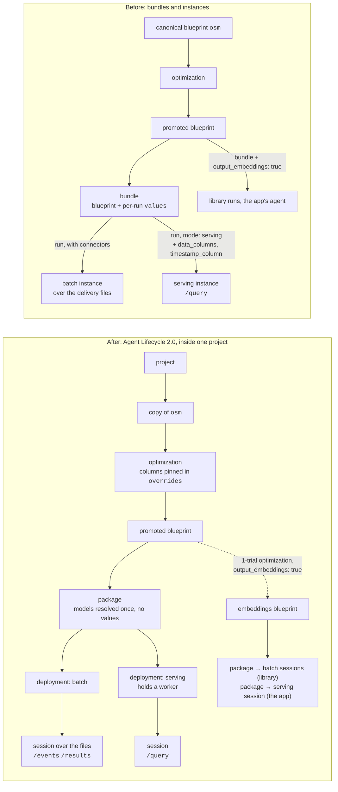
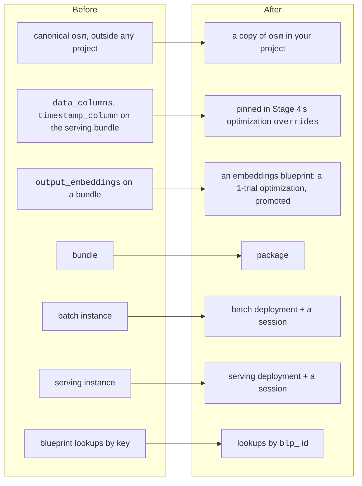

# Migrating to Agent Lifecycle 2.0

How this example moved from bundles and instances to **projects, packages,
deployments and sessions**, and what to watch for if you move your own scripts. The
[quickstart](https://github.com/archetypeai/operational-state-monitoring-agent-example-larco-quickstart)
made the same move first, and its Stages 4–9 were run end to end on it with both an
org-admin key and a member key. This example's scripts are the quickstart's, adapted
to its larger study (see [This repo, file by file](#this-repo-file-by-file)).

`/api/agents/bundles` and `/api/agents/instances` are being removed: some deployments of
the platform already answer 404 for them, and the rest keep them only until their next
platform release. Move to the calls below. A deployment serves the new calls
when `GET {root}/api/agents/sessions?limit=1` answers 200, not 404.

## Before and after

- **Project:** where everything lives. Every object takes its project from the one it
  was made from: an optimization from its blueprint, a promoted blueprint from its
  optimization, a package from its blueprint, a deployment from its package, a session
  from its deployment.
- **Package:** one blueprint, target `platform`, with its models resolved when it is
  built (the Omega encoder `mdl_…`, the fitted kNN `aar_…`). It has **no values**.
- **Deployment:** the package placed to run. `batch` is ready at once; `serving` places
  and loads the agent on a worker, usually within seconds, and holds that worker until
  it is stopped.
- **Session:** a run on a deployment. On `batch`, one run over its input files. On
  `serving`, a client's handle on the loaded agent, answering `/query` once it is
  `running` and staying open until it is cancelled or the deployment ends. Several
  sessions can share one serving deployment.

## What moved where

| Before | After | Why it changed |
|---|---|---|
| canonical `osm`, outside any project | a copy of `osm` in your project (`larco`) | a deployment needs a project, and everything takes its project from the blueprint it starts from |
| `data_columns`, `timestamp_column` as serving-bundle values | pinned in Stage 4's `overrides` | a package has no values; the serving source reads them from the blueprint (batch reads the CSV header) |
| `output_embeddings: true` on a bundle | an embeddings blueprint | an output can't be switched on per run any more |
| bundle | package | its models are resolved once, at build time |
| instance (batch) | batch deployment + a session | the deployment is set up once; each run is a session |
| instance (serving) | serving deployment + a session | the deployment holds the loaded agent; sessions are clients of it |
| `GET /blueprints/{key}` | `GET /blueprints/{blp_id}` | a key registered in a project resolves only with `?project_id=` |
| `/logs` | session `status`, `error`, `/events` | a session reaches a terminal status and says why |

## Old calls, new calls

All paths are under `{root}/api/agents` unless shown otherwise.

| Before | After |
|---|---|
| — | `POST {root}/api/projects` `{name, description}` |
| optimize the canonical `osm` | `POST /blueprints/osm/copy` `{project_id, blueprint_key}`, then optimize the copy |
| `POST /bundles` `{blueprint, values}` | `POST /packages` `{blueprint_ids: [blp_…], target: {kind: "platform"}, name}`; poll until `ready` |
| `POST /bundles/{id}/run` `{connectors}` | `POST /deployments` `{package_id, kind: "batch"}`, then `POST /sessions` `{deployment_id, connectors: {source: [...]}}` |
| `POST /bundles/{id}/run` `{mode: "serving"}` | `POST /deployments` `{package_id, kind: "serving"}`; poll until `ready`; `POST /sessions` `{deployment_id}`; poll until `running` |
| `GET /instances/{id}` | `GET /sessions/{id}` (`status`, `error`, `job_id`) |
| `GET /instances/{id}/events`, `/logs` | `GET /sessions/{id}/events` (newest first; there is no `/logs`) |
| `GET /instances/{id}/results` | `GET /sessions/{id}/results` |
| `POST /instances/{id}/query` | `POST /sessions/{id}/query` (same body, same `response`) |
| `POST /instances/{id}/cancel`, `DELETE /instances/{id}` | `POST /sessions/{id}/cancel`, `DELETE /sessions/{id}` |
| `DELETE /bundles/{id}` | `POST /deployments/{id}/stop`, `DELETE /deployments/{id}`, then `DELETE /packages/{id}` |
| `GET /instances?bundle_id=` | `GET /deployments?package_id=`, `GET /sessions?deployment_id=` |

Statuses: package `building → ready | failed`; deployment `deploying → ready → stopping
→ stopped | failed`; session `pending → running → completed | failed | cancelled` (and
`paused`). A package's `latest_runs` lists its sessions (`ses_…` ids).

## What changed in practice

1. **Get into a project by copying `osm`.** A deployment needs its package in a project,
   and a package lands in its blueprint's project. The canonical `osm` is outside any
   project, and `POST /optimizations` takes no `project_id`, so Stage 4b copies `osm`
   into the project `LARCO OSM` under the key `larco` and optimizes the copy
   (`fit/atai.py`, `base_blueprint()`). Stage 4c and Stage 9's 1-trial optimization
   reuse the same project and copy.

2. **Pin at Stage 4 what later stages need.** A bundle could add values per run; a
   package runs the promoted blueprint as stored. Stage 8's serving source reads
   `data_columns` and `timestamp_column` from values (a served query has no CSV header),
   so Stages 4b and 4c pin them, next to `states`. `fit/serve.py` refuses a blueprint
   that doesn't pin them.

3. **The step doesn't change here.** The chosen trial runs at window 512, step 512, and
   the bundle delivered at that same step, so Stages 6 and 8 score the same windows they
   did before.

4. **One batch deployment, several sessions.** Stage 6 delivers 122 files. It builds
   one package and one batch deployment, then runs the files in sessions of
   `--files-per-run` (25 by default, so 5 sessions), where it used to run one bundle per
   batch. `fit/out/delivery/runs.json` records the package, the deployment and every
   session before it waits on any of them, so `--resume` collects without starting
   anything again and `fit/cleanup.py` finds them after a failure. `--only` checks a
   few cycles the same way, in `fit/out/delivery_check/`.

5. **Embeddings need their own blueprint.** The library view and the app need each
   window's embeddings, which an agent returns only with `output_embeddings: true`.
   `fit/library_embeddings.py` now makes an embeddings blueprint: a 1-trial optimization
   at Stage 5's trial's point (window, step, k, metric, weights) with the switch pinned,
   then promoted. Its kNN is refitted, but embeddings depend only on the encoder and the
   windowing. The app's bridge serves the same blueprint, when it was made from the
   current Stage 5 blueprint.

6. **Let the platform choose the key.** `fit/test.py` and `fit/library_embeddings.py`
   promote without a `blueprint_key`, and the platform keys each blueprint after the
   copy and its trial, `larco-otr_<trial id>`, so Stage 5's blueprint, Stage 9's
   embeddings blueprint and a rerun's never ask for a key that is taken.
   `--blueprint-key` on `fit/test.py` chooses one, which takes the admin role.

7. **Look blueprints up by id.** `GET /blueprints/{key}` resolves a key registered in a
   project only with `?project_id=`; the scripts and the bridge use the `blp_` id.

8. **No admin-only calls.** Two calls that would need the org-admin role are avoided or
   have a fallback:
   - `POST /blueprints` (registering an edited copy of a promoted blueprint, e.g. with
     embeddings on) takes the admin role; the 1-trial optimization doesn't;
   - choosing `blueprint_key` on promote can take it too: the scripts send none unless
     asked (item 6).

9. **A session's result `ref` is a root path.** `/sessions/{id}/results` returns
   `ref: "/api/files/<fil_…>/content"`, which already includes `/api`: resolve it against
   the deployment root (`fit/atai.py`, `result_url`).

10. **Reads retry.** A GET that times out, drops its connection or ends early is retried
    (`fit/atai.py`, `request`), and so is each result download in Stage 6 (`fetch`), which
    pulls 122 large outputs. A POST is never retried, so nothing is created twice.

11. **Cleanup goes session, deployment, package.** Each holds the next. Cancel a session
    that is still going and stop a deployment that is still up before deleting them.
    `fit/cleanup.py` starts from each recorded package and lists its deployments and their
    sessions, so ones a script never recorded are found too. It keeps the embeddings
    blueprint's id in `fit/out/library_state.json`, for a rerun and for the app.

## This repo, file by file

| File | Change |
|---|---|
| `fit/atai.py` | the project `LARCO OSM` and its copy of `osm` (`base_blueprint()`), `create_package` and `package_ready`, `deploy` and `deployment_ready`, `open_session`, `wait_running`, `end`, `result_url`; GETs retried |
| `fit/optimize.py` | optimize the project's copy; `data_columns`, `timestamp_column` (and `states`) pinned |
| `fit/test.py` | the promoted key ends with the trial id; an earlier promotion looked up by id |
| `fit/deliver.py` | a package, one batch deployment, sessions of 25 files; results through their ref, downloads retried |
| `fit/serve.py` | a serving deployment and one session; all three deleted on exit |
| `fit/library_embeddings.py` | the embeddings blueprint, then a package, a batch deployment and a session per library file |
| `app-serving/scripts/serving-bridge.js` | the embeddings blueprint, packaged, deployed for serving, a session; a session that stops taking queries is replaced, with a new deployment if the old one is gone |
| `fit/cleanup.py` | sessions, deployments, packages, found from each package |

## Results

The numbers in the [README](README.md) were measured with bundles, on production.
On this branch, Stage 4b was rerun from scratch on a deployment that serves the new
calls: its 16-trial search (a new random draw) scored 0.68–0.76 on the 6 search cycles,
best 0.7562 (window 512, step 1,024, k 31, cosine), against 0.7547 for the README's best.
Stages 4c–9 were then rerun on the same deployment, at the README's point (window 512,
step 512, k 31, cosine, uniform):

| Stage | README (bundles) | This branch |
|---|---|---|
| 4c, all 21 validation cycles | 0.7562, bar 0.7511 | 0.7562, bar 0.7511 |
| 5, test, all 18 cycles | 0.7537, bar 0.7365 | 0.7537 (67,585 windows), bar 0.7365 |
| 5, without `cold_cotton_40_2` / that cycle alone | 0.7481 / 0.8584 | 0.7481 / 0.8584 |
| 6, delivery | 122 files | 122/122 files, 365,414 windows, 0 invalid |
| 7, delivery score | 0.7008, bar 0.6927 | 0.7008, bar 0.6927 |
| 8, served vs batch: state identical / probabilities within 1e-4 | 3,176 / 3,170 of 3,178 | 3,178 / 3,172 of 3,178 |
| 8, macro-F1 served / batch | 0.7966 / 0.7962 | 0.7966 / 0.7966 |
| 8, latency median / p95 / max | 521 / 773 / 2,011 ms | 414 / 486 / 629 ms |
| 9, library view | 3,200 windows, 79% nearest their own state's centre | the same, every value within 3e-5 |

Stage 8's few differing windows vary from run to run with bundles too (3,176–3,177 and
3,170–3,171 in the README's runs). The app ran end to end on the new embeddings
blueprint and removed its session, deployment and package when stopped.

## Moving your own scripts

1. Create a project, or reuse yours, and copy the blueprint you start from into it.
2. Move every per-run `values` override into the optimization's `overrides` (columns a
   serving source needs, outputs), or into a separate promoted blueprint if only some
   runs need it.
3. Replace `bundles` with a package (poll until `ready`), and each run with a session on
   a `batch` or `serving` deployment.
4. Look blueprints in a project up by `blp_` id, or pass `?project_id=` with a key.
5. Read `/sessions/{id}/events` and `/results`, and resolve result refs against the root,
   not against `…/api`.
6. Clean up sessions, then deployments, then packages; stop serving deployments when
   you're done, since each holds a worker.
